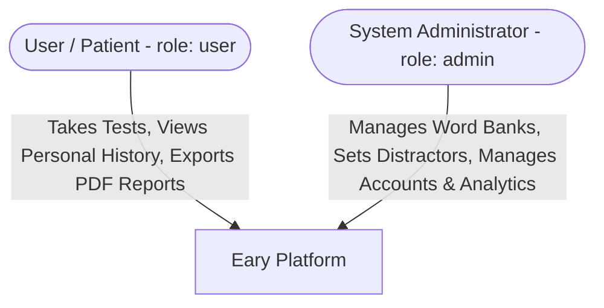
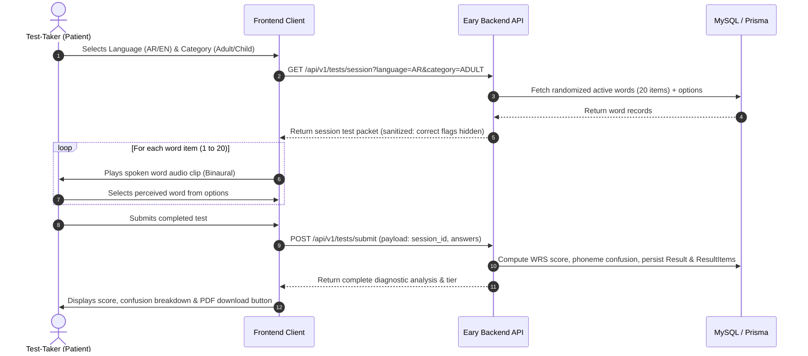

# Product Requirement Document (PRD)
## Project: Eary System – Language Words Hearing Assessment Platform

**Document Version:** 2.0.0  
**Status:** Approved / Active  
**Author / Team:** Eary Engineering & Product Team  
**Last Updated:** October 2026  

---

## 1. Executive Summary & Vision

### 1.1 Executive Summary
**Eary** is a web-based speech discrimination assessment platform designed to evaluate auditory recognition through interactive language-based hearing tests. Designed and built with a clean, modern architecture from the ground up, Eary delivers **Language Words Hearing Tests (Speech Discrimination / Word Recognition Testing)** in **Arabic** and **English**, tailored for both pediatric (children) and adult demographics.

The system provides test-takers with an accessible, clinically informed self-screening tool, while providing administrators with a robust Content Management System (CMS) to manage spoken audio recordings, minimal pair distractor options, and review patient diagnostic histories.

### 1.2 Core Value Proposition & System Objectives
- **Modern Clean Architecture**: Modular 3-tier structure (`Routes -> Controllers -> Services -> Prisma ORM -> MySQL`) with clear separation of concerns.
- **Stateless JWT Security**: Industry-standard JSON Web Tokens with cryptographically signed payloads, secure refresh token rotation, and strict Role-Based Access Control (`user` vs. `admin`).
- **Accurate Speech Discrimination**: Tests real-world auditory processing using standardized phonetically balanced word lists and minimal pairs (phonetic distractors).
- **Dual-Language & Demographic Focus**: Native support for Arabic and English across Pediatric (children) and Adult tiers.
- **Dynamic Session Assembly**: Randomized test generation (20 words per session) drawn from an active word bank to prevent test memorization.
- **Actionable Diagnostic Analytics**: Instant calculation of Word Recognition Score (WRS %), speech discrimination tier classification (Excellent, Good, Fair, Poor), phoneme confusion breakdown, and downloadable clinical PDF reports.

---

## 2. User Personas & Role Hierarchy

Eary enforces a strict **2-tier role hierarchy** managed via enum-based claims in JWT payloads:



### 2.1 Persona 1: Test-Taker / Patient (`role: user`)
- **Profile**: Individuals seeking to screen their hearing, monitor speech discrimination changes, or parents testing their children's audio perception.
- **Capabilities & Objectives**:
  - Register and authenticate via secure JWT login.
  - Complete binaural (both ears together) spoken word identification assessments.
  - View immediate diagnostic results: WRS score (%), classification tier, and phoneme confusion analysis.
  - Review chronological test progression over time.
  - Download or share clinical-grade PDF summary reports.

### 2.2 Persona 2: System Administrator (`role: admin`)
- **Profile**: System administrators and audiological content curators who oversee the platform's linguistic word bank and operational integrity.
- **Capabilities & Objectives**:
  - Manage user accounts (inspect, activate, deactivate, manage roles).
  - Curate the Word Bank: upload spoken audio clips (`.wav`, `.mp3`), designate the target correct word, configure phonetically similar distractor choices (minimal pairs), and assign language (`AR` / `EN`) and demographic category (`ADULT` / `CHILD`).
  - Monitor test analytics, completion rates, and platform diagnostic trends.

---

## 3. Product Features & Functional Requirements

### 3.1 Authentication & Account Management

| ID | Requirement | Specification |
| :--- | :--- | :--- |
| **FR-AUTH-01** | User Registration | Sign up with `name`, `email`, `phone`, `password`, `dob` (date of birth), `gender`, and demographic preferences (`preferred_language`). Passwords hashed with `bcrypt` (salt rounds: 10). |
| **FR-AUTH-02** | User Login & JWT Issuance | Authenticate email and password. On success, issue a short-lived Access Token (JWT, 15m) and a secure Refresh Token (7d). |
| **FR-AUTH-03** | Token Refresh & Revocation | Exchange valid refresh tokens for new access tokens. Support explicit logout with refresh token revocation. |
| **FR-AUTH-04** | Account Status Guard | Active status enforcement (`status: ACTIVE` vs `status: INACTIVE`). Deactivated accounts are rejected across all endpoints with a `403 Forbidden`. |
| **FR-AUTH-05** | Role-Based Access Control | Middleware guards (`authenticateToken`, `requireAdmin`) enforcing permissions strictly derived from signed JWT claims (`role: user` vs `role: admin`). |
| **FR-AUTH-06** | Profile Management | Authenticated endpoints for users to view and update their profile data and password securely. |

---

### 3.2 Language Words Hearing Test (Assessment Engine)



#### 3.2.1 Test Configuration & Word Bank Mechanics
- **Linguistic Word Lists**:
  - **Arabic Word Lists**: Spoken phonetically balanced Arabic words (الفصحى), featuring phonemes susceptible to discrimination loss (e.g., /س/ vs. /ش/, /ت/ vs. /ط/, /د/ vs. /ض/).
  - **English Word Lists**: Standardized speech discrimination lists (phonetically balanced monosyllables, minimal pairs such as "cat"/"bat", "pin"/"pen").
- **Target Demographics**:
  - **Pediatric (Children)**: Vocabulary familiar to children; clear, engaging voice talent.
  - **Adult**: Full phonetically balanced discrimination sets.
- **Audio Delivery Mode**:
  - **Binaural Listening**: Single composite test evaluating both ears together. No ear separation requirement.
  - Pre-test volume check prompt advising test-takers to set their audio output to a comfortable, clear conversational volume using headphones.

#### 3.2.2 Test Session Assembly
- **Dynamic Word Bank**: The platform uses randomized dynamic test sessions.
- When a user initiates a test for a given language (`language`) and target group (`category`), the backend pulls a **randomized subset of 20 questions** from the active question bank.
- **Anti-Cheat / Privacy**: When serving questions to the patient client, the backend sanitizes answer choices so that the correct indicator (`is_correct: true`) is **never exposed** in the client payload prior to test submission.

#### 3.2.3 Interaction Model
- For each test item, the audio clip is played.
- The user is presented with **Multiple Choice Options**:
  - 1 Target Word (Correct).
  - 2 to 3 Distractor Words (Phonetically similar minimal pairs or foils).
- The user selects the word they heard and clicks Next.

---

### 3.3 Diagnostic Scoring & Results Interpretation

#### 3.3.1 Word Recognition Score (WRS) Formula
$$\text{WRS (\%)} = \left( \frac{\text{Number of Correct Words Identified}}{\text{Total Number of Words in Session}} \right) \times 100$$

#### 3.3.2 Speech Discrimination Classification Tiers

| Score Range (WRS %) | Classification Tier | Diagnostic Interpretation | Recommended Action |
| :---: | :---: | :--- | :--- |
| **90% – 100%** | **Excellent** | Normal speech discrimination within standard conversational limits. | Routine periodic screening in 12 months. |
| **76% – 88%** | **Good** | Slight speech discrimination difficulty, primarily in soft conversational tones or noisy environments. | Re-test in 6 months; monitor difficulty in noisy venues. |
| **60% – 74%** | **Fair** | Moderate speech discrimination difficulty; frequent auditory confusion on similar sounding words. | Consultation with an Audiologist / ENT specialist recommended. |
| **< 60%** | **Poor** | Significant speech discrimination handicap; substantial difficulty deciphering spoken words. | Prompt clinical audiometric evaluation and diagnostic workup strongly advised. |

#### 3.3.3 Phoneme Confusion Breakdown
The result evaluation engine compares the selected distractor against the correct word to categorize the specific phonetic confusion pattern:
- **Consonant Voicing Error** (e.g., /b/ vs /p/, /d/ vs /t/).
- **Place of Articulation Error** (e.g., /f/ vs /th/, /s/ vs /sh/).
- **Vowel Height / Formant Error** (e.g., /i/ vs /e/).

#### 3.3.4 Comprehensive PDF Report Generation
The system generates a branded, downloadable PDF test report containing:
- Patient Name, Date, Test ID, and Demographics.
- Test Parameters: Language, Category (Adult/Pediatric), Number of Items.
- Overall WRS Score and Classification Badge (Color-coded: Green, Blue, Yellow, Red).
- Phonetic error breakdown table showing words misidentified and selected distractors.
- Clinical advisory disclaimer ("Screening tool; does not replace comprehensive medical diagnosis").

---

### 3.4 Admin Content Management System (CMS)

| ID | Capability | Description |
| :--- | :--- | :--- |
| **FR-CMS-01** | Spoken Audio Upload | Upload audio files (`.wav`, `.mp3`) stored locally on disk under `uploads/audio/` with sanitized, collision-resistant filenames. |
| **FR-CMS-02** | Word Item Authoring | Create/edit word items with fields: Target Word, IPA/Diacritic Transcription (`ipa_transcription`), Audio File, Language (`AR` \| `EN`), Category (`ADULT` \| `CHILD`), Status (`ACTIVE` \| `INACTIVE`). |
| **FR-CMS-03** | Distractor Management | Define multiple choice answers per word item, designating the target correct word (`is_correct: true`) and distractor foils (`is_correct: false`). |
| **FR-CMS-04** | Medical Audit Protection | Deactivating or soft-deleting words (`status: INACTIVE`) preserves historical patient audit records (`ResultItem`) via foreign key restrictions (`onDelete: Restrict`). |
| **FR-CMS-05** | User Administration | View paginated patient accounts, toggle activation status (`status: ACTIVE` / `INACTIVE`), update roles (`role: user` / `role: admin`), and review individual test histories. |

---

## 4. System Architecture & Database Schema

### 4.1 Modular Directory Structure (Clean 3-Tier)

```text
eary-backend/
├── src/
│   ├── config/             # Environment, database, and JWT configs
│   │   ├── env.js
│   │   └── prisma.js
│   ├── controllers/        # Request/Response orchestration
│   │   ├── auth.controller.js
│   │   ├── user.controller.js
│   │   ├── word.controller.js
│   │   ├── test.controller.js
│   │   └── report.controller.js
│   ├── services/           # Pure business logic & database queries
│   │   ├── auth.service.js
│   │   ├── user.service.js
│   │   ├── word.service.js
│   │   ├── scoring.service.js
│   │   └── pdf.service.js
│   ├── routes/             # Express API route definitions
│   │   ├── index.js        # Central router (/api/v1)
│   │   ├── auth.routes.js
│   │   ├── user.routes.js
│   │   ├── word.routes.js
│   │   ├── test.routes.js
│   │   └── report.routes.js
│   ├── middleware/         # Auth, validation, uploads, error handling
│   │   ├── auth.middleware.js
│   │   ├── validate.middleware.js
│   │   ├── upload.middleware.js
│   │   └── error.middleware.js
│   ├── utils/              # Helper utilities (scoring formula, phoneme map, logger)
│   │   ├── phonemeClassifier.js
│   │   └── responseHandler.js
│   └── app.js              # Express app setup & middleware mounting
├── prisma/
│   ├── schema.prisma       # Clean, modern Prisma schema
│   ├── migrations/         # Database migrations
│   └── seed.js             # Seeder with Arabic & English word banks
├── uploads/
│   └── audio/              # Spoken audio file storage
├── docs/                   # Documentation
│   ├── PRD.md
│   ├── ARCHITECTURE.md
│   └── API_SPEC.md
├── server.js               # Application entry point (server listener)
├── package.json
└── .env.example
```

### 4.2 Modern Prisma Database Schema

```prisma
datasource db {
  provider = "mysql"
  url      = env("DATABASE_URL")
}

generator client {
  provider = "prisma-client-js"
}

enum Role {
  USER  @map("user")
  ADMIN @map("admin")
}

enum UserStatus {
  ACTIVE   @map("active")
  INACTIVE @map("inactive")
}

enum Language {
  AR @map("ar")
  EN @map("en")
}

enum Category {
  ADULT @map("adult")
  CHILD @map("child")
}

enum DiscriminationTier {
  EXCELLENT @map("excellent")
  GOOD      @map("good")
  FAIR      @map("fair")
  POOR      @map("poor")
}

model User {
  id           Int          @id @default(autoincrement())
  name         String       @db.VarChar(255)
  email        String       @unique @db.VarChar(255)
  password     String       @db.VarChar(255)
  phone        String?      @db.VarChar(20)
  dob          DateTime?    @db.Date
  gender       String?      @db.VarChar(10) // "male", "female"
  role         Role         @default(USER)
  status       UserStatus   @default(ACTIVE)
  refreshToken String?      @db.Text
  createdAt    DateTime     @default(now())
  updatedAt    DateTime     @updatedAt
  results      Result[]

  @@map("users")
}

model Question {
  id                Int          @id @default(autoincrement())
  word              String       @db.VarChar(255) // Target spoken word
  ipa_transcription String?      @db.VarChar(255) // Phonetic script / Arabic diacritics
  audio_file        String       @db.VarChar(255) // Stored filename under uploads/audio
  language          Language     @default(AR)
  category          Category     @default(ADULT)
  status            UserStatus   @default(ACTIVE)
  createdAt         DateTime     @default(now())
  updatedAt         DateTime     @updatedAt
  options           Answer[]
  resultItems       ResultItem[]

  @@map("questions")
}

model Answer {
  id          Int          @id @default(autoincrement())
  text        String       @db.VarChar(255) // Displayed option text
  is_correct  Boolean      @default(false)  // true for target word, false for distractors
  phoneme_tag String?      @db.VarChar(50)  // e.g. "voicing", "place", "fricative"
  question_id Int
  question    Question     @relation(fields: [question_id], references: [id], onDelete: Restrict)
  resultItems ResultItem[]

  @@index([question_id])
  @@map("answers")
}

model Result {
  id               Int                @id @default(autoincrement())
  score            Float              // WRS percentage (0.0 to 100.0)
  tier             DiscriminationTier // EXCELLENT, GOOD, FAIR, POOR
  language         Language           @default(AR)
  category         Category           @default(ADULT)
  total_questions  Int                @default(20)
  correct_count    Int                @default(0)
  duration_seconds Int?               // Time taken to complete test
  error_summary    Json?              // Cached phonetic confusion summary
  date             DateTime           @default(now())
  user_id          Int
  user             User               @relation(fields: [user_id], references: [id], onDelete: Cascade)
  items            ResultItem[]

  @@index([user_id])
  @@map("results")
}

model ResultItem {
  id                 Int      @id @default(autoincrement())
  result_id          Int
  result             Result   @relation(fields: [result_id], references: [id], onDelete: Cascade)
  question_id        Int
  question           Question @relation(fields: [question_id], references: [id], onDelete: Restrict)
  selected_answer_id Int
  selected_answer    Answer   @relation(fields: [selected_answer_id], references: [id], onDelete: Restrict)
  is_correct         Boolean  @default(false)

  @@index([result_id])
  @@index([question_id])
  @@index([selected_answer_id])
  @@map("result_items")
}
```

---

## 5. Non-Functional Requirements (Lean Specification)

### 5.1 Performance & Latency
- **API Response Time**: Under 200ms for standard REST query payloads (test session fetching, history, answer validation).
- **Audio Playback Latency**: Audio assets served via Express static middleware with proper caching headers (`Cache-Control: public, max-age=86400`) to guarantee instant sound playback on user tap.

### 5.2 Storage & File Management
- **Local Audio Storage**: Audio clips stored locally on disk under `uploads/audio/`.
- File naming strategy: `Date.now() + '-' + crypto.randomBytes(4).toString('hex') + path.extname(file.originalname)`.
- Supported formats: `.mp3` and `.wav`; maximum file size: 5 MB per clip.

### 5.3 Security & Data Protection
- **Standard SSL/TLS**: HTTPS encryption for all client-server communications in production.
- **Credential Storage**: Passwords hashed using `bcrypt` (10 salt rounds).
- **Signed JWT Tokens**: Stateless access tokens with short TTL (15m) + secure refresh token rotation.
- **Input Sanitization**: Request bodies validated via `express-validator` to neutralize injection risks and invalid payload states.
- **Information Masking**: Correct answer flags (`is_correct: true`) stripped from client payloads during active test sessions.

---

## 6. Execution Milestones

### Milestone 1: Clean Architecture Foundation & Scaffolding
- Initialize clean directory layout (`src/` with `controllers`, `services`, `routes`, `middleware`, `config`, `utils`).
- Establish centralized configuration (`src/config/env.js`) and database client (`src/config/prisma.js`).
- Configure global error handling, 404 handler, CORS, and request logging.

### Milestone 2: Schema Migration & Word Bank Seeding
- Apply the modernized `prisma/schema.prisma` with `Role` (`user`, `admin`), `UserStatus` (`active`, `inactive`), `Language` (`ar`, `en`), `Category` (`adult`, `child`), and `ResultItem`.
- Write a rich database seeder (`prisma/seed.js`) generating admin accounts and initial Arabic & English minimal-pair word banks with audio mappings.

### Milestone 3: JWT Authentication & User Management
- Implement `auth.service.js` and `auth.controller.js` for registration, login, token refresh, and logout.
- Implement `auth.middleware.js` for JWT verification and role checking (`role: user` vs `role: admin`).
- Implement user profile management and admin user management.

### Milestone 4: Word Bank CMS & Dynamic Test Engine
- Implement audio upload handling (`upload.middleware.js`) and word bank CRUD endpoints.
- Build dynamic test session generator (`GET /api/v1/tests/session`) with randomization and answer masking.
- Build test submission handler (`POST /api/v1/tests/submit`) computing WRS %, tier classification, and phoneme error tagging.

### Milestone 5: PDF Reports & Documentation
- Implement PDF report generation service using `pdfkit`.
- Complete [docs/ARCHITECTURE.md](file:///d:/www/eary-backend/docs/ARCHITECTURE.md) and [docs/API_SPEC.md](file:///d:/www/eary-backend/docs/API_SPEC.md).

---

## 7. Metrics & Success Criteria

1. **Test Completion Rate**: $\ge 85\%$ of users who start a 20-word test session complete all items.
2. **Audio Reliability**: $\le 0.5\%$ audio playback error/failure rate across client devices.
3. **Scoring Accuracy**: $100\%$ deterministic calculation of WRS percentage and categorization against defined benchmark thresholds.
4. **Diagnostic Utility**: Test-takers successfully export or view actionable phonetic confusion summaries within 2 seconds of test submission.
