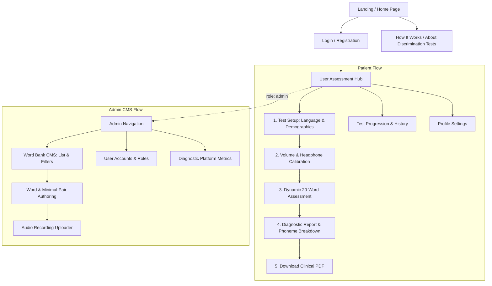
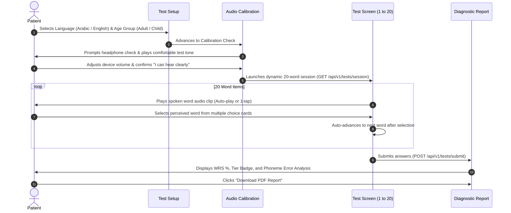
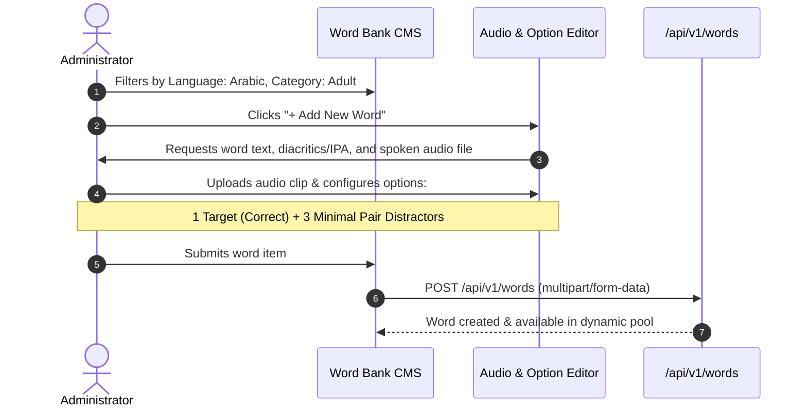

# User Experience (UX) Specification
## Project: Eary System – Language Words Hearing Assessment Platform

**Document Version:** 2.0.0  
**Status:** Approved / Active  
**Author / Team:** Eary Design & Product Team  
**Last Updated:** October 2026  

---

## 1. UX Vision & Emotional Architecture

Audiological and speech discrimination testing can evoke anxiety regarding sensory health. The **Eary UX framework** is engineered to establish:
- **Calm Reassurance**: A welcoming, unhurried atmosphere that minimizes testing stress.
- **Cognitive Simplicity**: Single-focus screens that eliminate peripheral distractions while listening to delicate spoken phonemes.
- **Diagnostic Confidence**: Clear, non-stigmatizing medical explanations that translate raw scores into actionable health guidance.

---

## 2. Information Architecture & Sitemap

---

## 3. End-to-End User Journeys

### 3.1 Journey 1: First-Time Patient Speech Discrimination Test

#### Step Details:
1. **Language & Category Onboarding**:
   - Patient picks Arabic or English.
   - System defaults category based on patient's profile age, with an option to manually toggle (`Adult` vs `Pediatric`).
2. **Audio & Headphone Calibration Guard**:
   - A 5-second sample sound is played.
   - The user confirms headphones are positioned properly and volume is comfortable.
   - Prevents flawed tests caused by muted speakers or low volume.
3. **Active Word Test Experience**:
   - The test displays Word Number (e.g., `7 of 20`) and progress bar.
   - A spoken word is played binaurally.
   - User has up to **2 listens per word** (to measure true discrimination without excessive habituation).
   - 3 to 4 word options are displayed (target word + minimal pair distractors).
   - **Zero Mid-Test Feedback**: The interface never reveals whether an answer was right or wrong during the test. This prevents emotional discouragement or second-guessing.
4. **Instant Diagnostic Result & Consultation Guide**:
   - Total WRS score is revealed with smooth radial gauge animation.
   - Color-coded badge indicates clinical status (`Excellent`, `Good`, `Fair`, `Poor`).
   - Phonetic confusion breakdown highlights specific acoustic challenges (e.g., high-frequency consonant confusion like /s/ vs /sh/).
   - Clear recommendation on whether to consult an ENT/Audiologist.

---

### 3.2 Journey 2: Pediatric Assisted Flow (Parent Testing Child)
- **Visual Engagement**: For pediatric tests, the UI displays larger cards with cheerful, friendly accents and accessible word fonts.
- **Parental Guidance Banner**: A subtle advisory banner reminds parents: *"Please allow your child to listen and choose without prompting or assisting their answers."*
- **Replay Flexibility**: Allows parent to trigger replay if child was momentarily distracted.

---

### 3.3 Journey 3: Administrator Word Bank Curation

---

## 4. Interaction Rules & Ergonomics

### 4.1 Audio Playback Ergonomics
- **Auto-Play Trigger**: Each new question automatically plays the audio clip after a brief 400ms pause to allow visual orientation.
- **Play Limit**: Patients can replay the audio once (total of 2 plays per word item). The replay button shows `Replay (1 left)`.
- **Audio Loading Resilience**: If an audio file fails to buffer within 3 seconds, a friendly toast appears: *"Audio buffering... tap to retry"*, with a manual retry button.

### 4.2 Selection & Confirmation Behavior
- **Touch / Mouse Selection**: Tapping an option card highlights it immediately with the active teal border and checkmark.
- **Advance Trigger**: To maintain test velocity and flow, clicking an option enables the "Next Word" button. Optional: auto-advance after 500ms once selected (configurable in settings).
- **Keyboard Shortcuts**:
  - `1`, `2`, `3`, `4`: Select corresponding option card.
  - `Spacebar`: Replay audio clip.
  - `Enter`: Advance to next question.

### 4.3 Mid-Test Abort Safeguard
- If the patient clicks the close/exit button during an active test, a confirmation modal appears:
  - *“Leave test in progress? Your answers will not be saved and this session will be discarded.”*
  - Actions: **Continue Testing** (Primary) | **Quit Session** (Destructive / Secondary).

---

## 5. Result Delivery & Clinical Report Exploration

### 5.1 Hierarchical Result Disclosure (Progressive Disclosure)
- **Level 1 (Glanceable)**: Large score donut (`95%`), Tier badge (`EXCELLENT`), one-sentence clinical summary.
- **Level 2 (Diagnostic Drill-down)**: Phoneme Confusion Breakdown card showing which minimal pairs were confused and their linguistic classification (e.g., *Voicing Error: confused 'bat' with 'pat'*).
- **Level 3 (Formal PDF)**: Action button to download the signed, clinical-grade summary report for physician review.

### 5.2 Longitudinal Test Comparison
- In the Patient History dashboard, previous scores are mapped on a clean time-series graph, allowing patients to track hearing stability over months or years.
